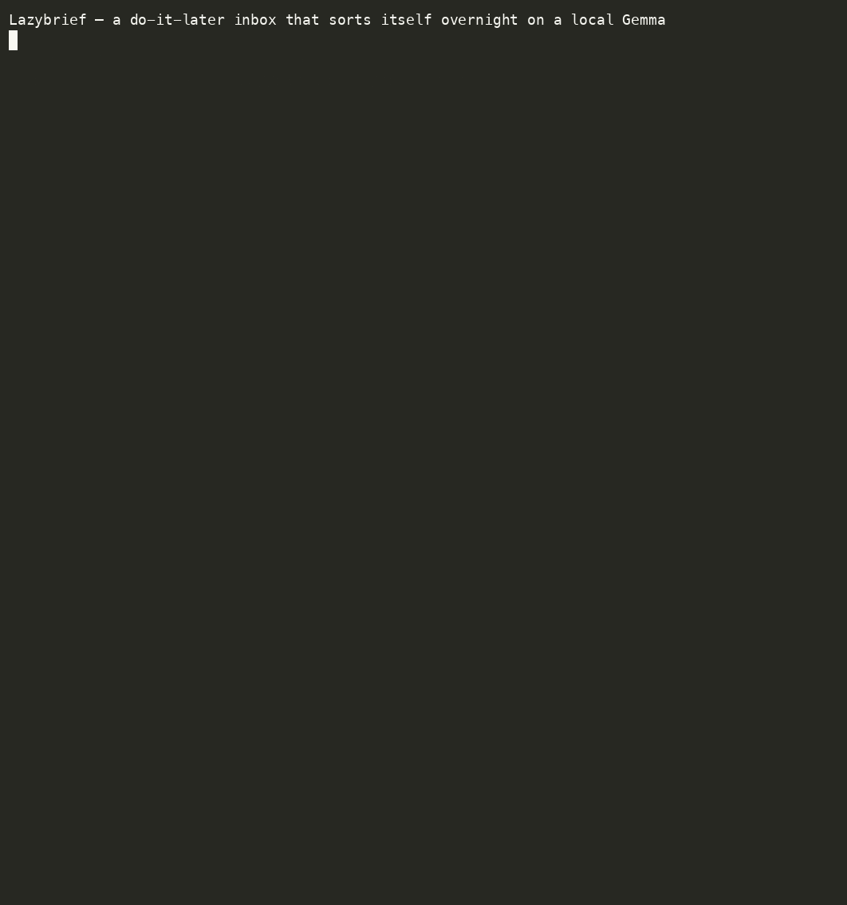

# Lazybrief

**A do-it-later inbox that sorts itself overnight on a local Gemma.**

Be lazy during the day: dump links, notes, and todos into the inbox with one
command. Overnight, a local open-weight model (Gemma via [Ollama](https://ollama.com))
reads the whole pile, dedupes it, clusters it by theme, assigns each cluster a
priority and a *do-it-later* schedule bucket, and collapses everything into a
**five-line morning brief**. You wake up to five lines instead of fifty tabs.

Nothing leaves your machine. No API key, no cloud bill, no account. The model is
open-weight; the agent harness around it ([Aeon](https://github.com/aeonfun/aeon),
aaronjmars's open-source project) is open-source. The whole thing is free and
offline.

Built for the [DEV Hacktoberfest Open-Source AI Challenge, Week 3 — "Slow and
Steady"](https://dev.to/devteam/join-the-hacktoberfest-open-source-ai-challenge-slow-and-steady-2850-in-prizes-across-21-3iee).

---

## Quick start (one command)

```bash
./setup.sh
```

That checks Python 3 (standard library only — nothing to `pip install`), and if
[Ollama](https://ollama.com) is installed, pulls the model. Then:

```bash
# be lazy — dump things all day, in any shape
python3 lazybrief.py add "https://arxiv.org/abs/2610.01234 agent memory paper"
python3 lazybrief.py add "TODO renew the domain before friday"
echo "idea: warm the model so the overnight run starts faster" | python3 lazybrief.py add

# later (or on a cron) — let the model sort it
python3 lazybrief.py brief
```



Real output from `gemma3` (3.9B, Q4) on an Apple M4 laptop, sorting the 11-item
sample inbox (the model wait, about 20 seconds, is trimmed in the recording):

```
*Lazybrief — 2026-10-20*
• Renew the domain before Friday.
• Reply to the brief length issue.
• Check the new Ollama release changelog.
• Investigate caching the model warmup.
• Drop: Newsletter already read.

(full brief: briefs/2026-10-20.md)
```

The full brief groups the same items into **Admin** (today), **Personal**
(today), **AI research** (this week), and **Dropped**.

No Ollama yet? You can still see the wiring work:

```bash
python3 lazybrief.py brief --offline   # type-grouped fallback, clearly labelled
```

The `--offline` path is a deterministic stand-in so the tool and demo never
hard-fail — but the actual clustering, prioritisation, and dedup are the model's
job. Gemma is what makes this useful.

---

## Commands

| Command | What it does |
|---|---|
| `lazybrief.py add "<text>"` | Dump a link / note / todo (auto-classified). Also reads stdin. |
| `lazybrief.py list` | Show the pending pile. |
| `lazybrief.py brief` | Sort the inbox with the model, write a dated brief, archive the items. |
| `lazybrief.py brief --offline` | Same, without a model (degraded; for testing/CI). |
| `lazybrief.py brief --keep` | Don't archive after briefing. |
| `lazybrief.py brief --brief-file <path>` | Also write the compact brief to a file (used by the Aeon skill). |
| `lazybrief.py stats` | Inbox / archive / brief counts. |
| `lazybrief.py doctor` | Check Ollama + model wiring. |

### Configuration (all optional, via env vars)

| Variable | Default | Meaning |
|---|---|---|
| `LAZYBRIEF_MODEL` | `gemma3` | Ollama model tag (e.g. `gemma3:4b`, `qwen2.5`). |
| `OLLAMA_HOST` | `http://localhost:11434` | Ollama base URL. |
| `LAZYBRIEF_HOME` | `./data` | Where the inbox, archive, and briefs live. |

No secrets. Nothing is committed: your inbox, archive, and briefs are written
under `data/`, which is `.gitignore`d.

---

## How it works

```
       during the day                        overnight / on a cron
  ┌───────────────────────┐            ┌──────────────────────────────┐
  │  add link / note /     │            │  local Gemma (Ollama)        │
  │  todo  ──────────────► │ inbox.jsonl│  dedupe → cluster → prioritise│
  │  (zero friction)       │  ────────► │  → schedule → 5-line brief    │
  └───────────────────────┘            └──────────────┬───────────────┘
                                                       │
                                     briefs/YYYY-MM-DD.md  +  ./notify
                                     (archive processed items)
```

- **Storage** is plain append-only JSONL. No database, no daemon.
- **The model makes two passes** over Ollama's local HTTP API with
  `format=json`. First it labels every item on its own (topic, priority,
  schedule). The code then groups items by topic. A small model is much more
  reliable at labelling one item at a time than at juggling item numbers
  inside clusters. Second, it writes the five-line brief from the grouped
  result, so the brief can only describe decisions that were actually made.
- **Nothing silently disappears.** Bad priorities or buckets are coerced,
  bogus item references are ignored, items the model skipped land in an
  "Unsorted" cluster, dropped items get their own "Dropped" cluster, and the
  brief is hard-capped at five lines.
- **As an Aeon skill**, an overnight schedule runs the brief and hands the five
  lines to Aeon's `./notify`, which delivers them to Telegram, Discord or Slack.
  Aeon supplies the scheduling, notification delivery and run log; Gemma
  supplies the thinking. Both are open.

---

## Run it nightly with Aeon

[Aeon](https://github.com/aeonfun/aeon) is an open-source agent harness. This
repo is an Aeon **community skill pack** — from the root of your Aeon repo:

```bash
bin/install-skill-pack NurstarK/lazybrief
```

That installs the skill (disabled by default). Then clone the app **outside**
your Aeon checkout, pinned to a release tag:

```bash
git clone --branch v0.1.0 --depth 1 https://github.com/NurstarK/lazybrief /opt/lazybrief
```

and enable it in `aeon.yml`, pointing `var` at the checkout (schedules are UTC):

```yaml
  lazybrief: { enabled: true, schedule: "0 5 * * *", var: "/opt/lazybrief" } # overnight do-it-later inbox -> 5-line brief (local Ollama)
```

The skill runs `doctor`, then `brief --brief-file <app>/data/notify.md`, then
`./notify --title "Lazybrief" -f <app>/data/notify.md`. If the model is down it
sends a warning instead of an empty brief.

**It has to run where Ollama runs.** Aeon's default home is hosted GitHub
Actions, and a hosted runner can't reach `localhost:11434` or your local inbox.
Run the skill on your own machine or a self-hosted runner. On a self-hosted
runner, keep the checkout outside the Aeon repo (as above): `actions/checkout`
wipes the Aeon workspace — inbox included — before every run.

**What's been tested:** this setup was checked against a fresh clone of
`aeonfun/aeon`. Aeon's config validator (`scripts/validate-config.js`) and
category lint pass with the entry above. The skill was run end to end through
Aeon's harness with `scripts/dry-run.sh run lazybrief` on an M4 Mac, using
Gemma 3 on Ollama. That mode captures notifications instead of sending them.
The run passed, and the captured `./notify` payload held the five-line brief.
With Ollama stopped, the skill queued the "model not ready" warning instead
and left the inbox untouched.
Delivery to a real Telegram, Discord or Slack channel has not been tested here.

## Tests

```bash
python3 tests/test_lazybrief.py
```

Runs fully offline (no model, no network) against a throwaway temp inbox:
exercises the add → list → brief → archive round-trip, the model-output
normaliser, the topic grouping, and the classifier.

---

## Demo

See [`demo/DEMO.md`](demo/DEMO.md) for a one-command terminal recording
(`./demo/record-demo.sh`) and an exact 60–90s screen-video script.

---

## License

MIT — see [LICENSE](LICENSE). The Aeon skill wrapper in `skill/` is meant to be
dropped into an [Aeon](https://github.com/aeonfun/aeon) install (aaronjmars's
open-source agent harness, also MIT).
